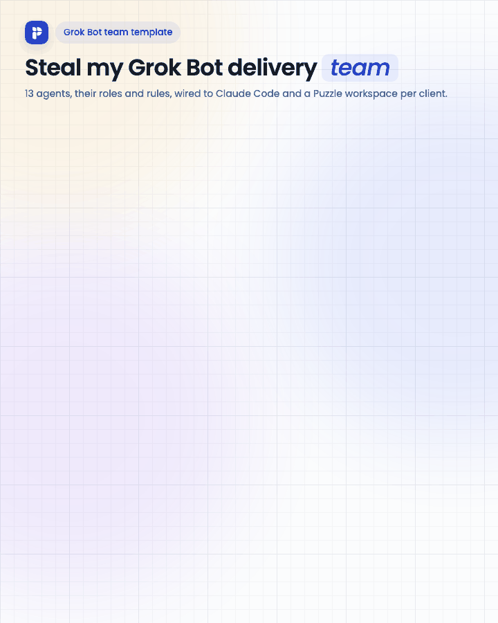
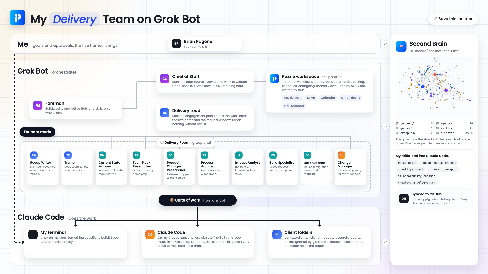
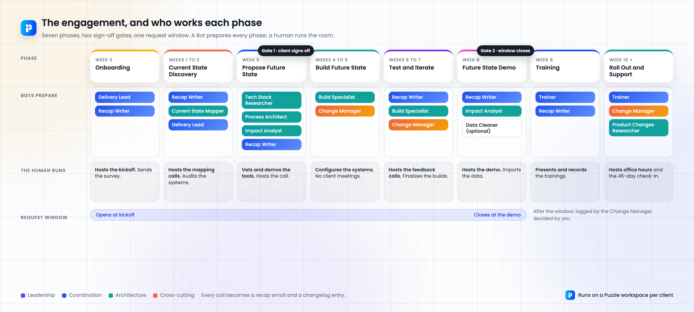

# Grok Bot delivery team

**13 Grok Bot agents that run a process consultancy's delivery. The client's Puzzle map is the shared memory. Claude Code does the work.**

[](assets/grokbot-delivery-team@2x.png)

I've run process optimization engagements since 2020: current state mapping, future state design, builds, data migration, training, launch support. The delivery system behind them is a spreadsheet of about sixty tasks across seven phases. When I read it honestly, most of those tasks are listening, drafting, mapping, and memorializing. A human has to do five of them. The rest are now Bots.

This repo is that team as a Grok Bot import: paste one prompt, answer eight questions, and the Bots are there with their jobs, their reporting lines, their rules, and the skills they hand to Claude Code.

**[Import the team in 1 prompt →](setup-prompt.md)** · [The 13 Bots](#the-team) · [The engagement](#the-engagement) · [The rules](guides/rules.md) · [Puzzle and the MCP](guides/puzzle-mcp.md) · [Claude Code](guides/claude-code.md)

## Import the team

1. Create a new Bot in Grok Bot and call it **Chief of Staff**.
2. Paste the prompt from **[setup-prompt.md](setup-prompt.md)** into its chat.
3. Answer its eight questions: who you are, the platforms you're expert in, the industries you serve, the clients you serve, the engagements you sell, your method, your stack, your boundaries. It creates the other Bots, the Delivery Room, and the two routines, then tells you what is left to do in the app.
4. Connect your tools in Grok Bot's settings. Each Bot's instructions already say which connectors it may use.

Nothing is sent or spent during setup. Prefer to do it by hand? Every file in [agents/](agents/) has the instructions block to paste.

## The team

| Bot | Job | Reports to |
|---|---|---|
| [Chief of Staff](agents/01-chief-of-staff.md) | Runs the team, sends every unit of work to Claude Code, messages you each weekday morning with status and the decisions that need you | You |
| [Foreman](agents/02-foreman.md) | Builds, edits, and retires Bots and skills when the team needs one | Chief of Staff |
| **Coordination** | | |
| [Delivery Lead](agents/03-delivery-lead.md) | Owns the engagement plan: scope in units, schedule, the weekly update, the request window, the two sign-off gates. Routes, never executes | Chief of Staff |
| [Recap Writer](agents/04-recap-writer.md) | Every call becomes a recap email draft and a list of build requests, decisions, and homework | Delivery Lead |
| [Trainer](agents/05-trainer.md) | Training deck, Loom scripts, post-training email, rollout email, office hours recap, 45-day check-in | Delivery Lead |
| **Architecture** | | |
| [Current State Mapper](agents/06-current-state-mapper.md) | Runs the interview guide, maps current state in the client's Puzzle workspace, shares the maps per team | Delivery Lead |
| [Tech Stack Researcher](agents/07-tech-stack-researcher.md) | Researches the future tech stack from the discovery calls, builds the cost comparison, preps the vet-and-demo | Delivery Lead |
| [Product Changes Researcher](agents/08-product-changes-researcher.md) | Watches releases on every tool you recommend and maps each change to the client processes it could improve | Delivery Lead |
| [Process Architect](agents/09-process-architect.md) | Scopes the future state builds, writes the recommendation, builds the future state map, produces the AI Opportunity Roadmap | Delivery Lead |
| [Impact Analyst](agents/10-impact-analyst.md) | Quantification of Impact before the build, Innovation Report after the demo, one cost model for both | Delivery Lead |
| [Build Specialist](agents/11-build-specialist.md) | Build spec per workflow, the build request tracker, the Loom walkthrough script, test plans. A human configures the systems | Delivery Lead |
| [Data Cleaner](agents/12-data-cleaner.md) | Optional. Collects, reviews, converts, and logs data for a migration. Never writes to a client system | Delivery Lead |
| **Cross-cutting** | | |
| [Change Manager](agents/13-change-manager.md) | A changelog entry in the client's workspace for every decision, scope change, and change request | Delivery Lead |
| [Delivery Room](agents/14-delivery-room.md) | The group chat where the Chief of Staff, the Delivery Lead, and the specialists hand work over | |



## How the work flows

```text
You            goals, approvals, the five things only a human does
  ↓
Grok Bot       13 Bots and 1 room; the Chief of Staff routes the work
  ↓
Claude Code    any Bot can send it a unit of work: outcome, inputs, skill, limits
  ↓
Your files     the client's Puzzle workspace, your second brain, your Drive;
               every result comes back as a draft for your review
```

The details are in **[guides/claude-code.md](guides/claude-code.md)**: the four-part handoff, persistent terminal sessions, one worktree per task, and why delivery work runs on your Mac.

## The engagement

Seven phases, two sign-off gates, one request window. Each phase has a Bot that prepares it and a human who runs the room.



| Phase | Bots | The human |
|---|---|---|
| Onboarding | Delivery Lead | Hosts the kickoff |
| Current State Discovery | Recap Writer, Current State Mapper | Hosts the mapping calls, audits the systems |
| Propose Future State | Tech Stack Researcher, Process Architect, Impact Analyst, Recap Writer | Vets and demos the tools, hosts the call. **Gate 1** |
| Build Future State | Build Specialist | Configures the systems |
| Test and Iterate | Recap Writer, Build Specialist, Change Manager | Hosts the feedback calls |
| Future State Demo | Recap Writer, Impact Analyst | Hosts the demo. **Gate 2**, request window closes |
| Data Migration (optional) | Data Cleaner | Imports |
| Training | Trainer | Presents and records |
| Roll Out and Support | Trainer, Change Manager | Hosts office hours and the 45-day check-in |

The full model, with the deliverables per phase, is in **[guides/engagement-model.md](guides/engagement-model.md)**. Everything the team touches is memorialized twice: a recap email to the client and a changelog entry in the client's workspace.

## What the Bots never do

Nothing is sent, posted, written to a client system, paid for, or deleted without your explicit yes on that exact item. Drafts are the default output everywhere. Every Bot's instructions end with the only connectors it may use. The full list is in **[guides/rules.md](guides/rules.md)**.

## What you need

- A Grok Bot account. That is enough to start.
- Claude Code, for the handoff. Without it, delete the handoff line from a Bot's instructions and it does the work itself.
- A [Puzzle](https://puzzleapp.io) workspace per client. The Bots read and write the client's map through the Puzzle MCP: workflows, teams, tools, data model, costing, shared views, and the changelog. A free workspace is enough to start.
- A call recorder. Otter, Granola, Avoma, Notion, or whatever you use. The Bots ask which at setup.
- Your automation stack. The Bots are written for Zapier, Make, and n8n. Swap the names if you use something else.
- A second brain with your method and your voice, if you have one. [context/](context/) is the scaffold the setup fills.

## Make it yours

```text
agents/       One file per Bot, 01 to 14, with the instructions block to paste
guides/       The rules, the engagement model, Puzzle and the MCP, Claude Code
context/      Your consultant profile and client folders; the glossary is the standard
skills/       The starter skills the Bots hand to Claude Code
examples/     One synthetic client, start to finish, so you can see finished output
assets/       The team animation, the system map, and the engagement map
assets/linkedin/  The dark version for LinkedIn: still, GIF, and MP4
setup-prompt.md
```

The scaffold starts blank. [examples/northstar-home-services/](examples/northstar-home-services/) is made up, start to finish, to show what a populated engagement looks like. Use your own method, clients, and voice when filling yours.

## License

[MIT](LICENSE). Built by [Brian Ragone](https://www.linkedin.com/in/bragone/), founder of [Puzzle](https://puzzleapp.io).
